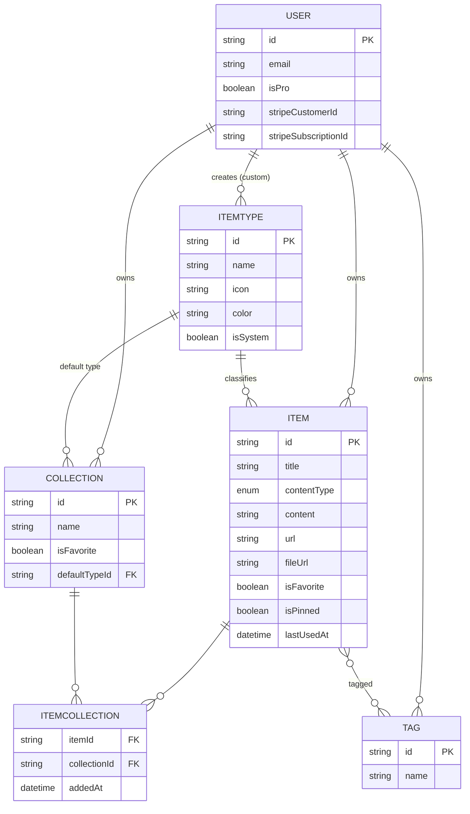
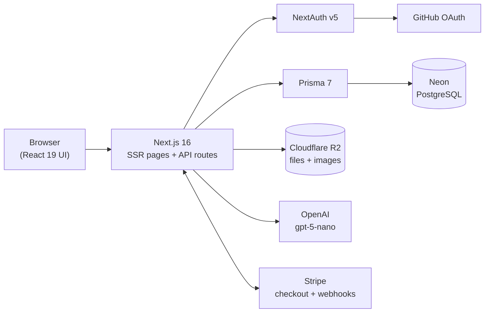

# 🧠 DevMind — Project Overview

> One fast, searchable, AI-enhanced hub for all your dev knowledge and resources.

**Contents:** [Problem](#-problem) · [Users](#-users) · [Features](#-features) · [Data model](#-data-model) · [Tech stack](#-tech-stack) · [Architecture](#-architecture) · [Monetization](#-monetization) · [UI/UX](#-uiux)

---

## 🎯 Problem

Developers keep their essentials scattered:

| What | Where it usually lives |
| --- | --- |
| Code snippets | VS Code, Notion |
| AI prompts | Chat histories |
| Context files | Buried in projects |
| Useful links | Browser bookmarks |
| Docs | Random folders |
| Commands | `.txt` files, bash history |
| Project templates | GitHub gists |

The result is context switching, lost knowledge, and inconsistent workflows. **DevMind** puts all of it in one place.

## 👥 Users

| Persona | Needs |
| --- | --- |
| **Everyday Developer** | Grab snippets, prompts, commands, and links fast |
| **AI-first Developer** | Save prompts, contexts, workflows, system messages |
| **Content Creator / Educator** | Store code blocks, explanations, course notes |
| **Full-stack Builder** | Collect patterns, boilerplates, API examples |

---

## ✨ Features

### A. Items and item types

Every item has a type. There are seven **system types** that cannot be edited or deleted. Custom user-defined types come later (Pro).

| Type | Content kind | Route | Tier |
| --- | --- | --- | --- |
| Snippet | text | `/items/snippets` | Free |
| Prompt | text | `/items/prompts` | Free |
| Note | text | `/items/notes` | Free |
| Command | text | `/items/commands` | Free |
| Link | url | `/items/links` | Free |
| File | file | `/items/files` | **Pro** |
| Image | file | `/items/images` | **Pro** |

Items are created and opened in a **drawer**, so the user never leaves the page they are on.

### B. Collections

- A collection holds items of any type.
- An item can belong to **multiple collections** (a React snippet can sit in both "React Patterns" and "Interview Prep").
- Examples: *React Patterns* (snippets, notes), *Context Files* (files), *Python Snippets* (snippets).

### C. Search

Search across **content, tags, titles, and types**. Search is the same on Free and Pro — it is the core promise of the product, and the item cap is what drives upgrades.

### D. Authentication

- Email + password
- GitHub OAuth

### E. Other features

- Favorites for collections and items
- Pin items to top
- Recently used
- Import code from a file
- Markdown editor for text types
- File upload for file types (file, image)
- Export data (JSON / ZIP) — Pro
- Dark mode by default
- Add/remove an item to/from multiple collections
- See which collections an item belongs to

### F. AI features (Pro only)

- Auto-tag suggestions
- Summaries
- Explain this code
- Prompt optimizer

---

## 🗄 Data model

### ER diagram



### Prisma schema (draft)

A starting point, not final. Written for Prisma 7 — confirm generator/config syntax against the [latest docs](https://www.prisma.io/docs) before the first migration.

```prisma
// prisma/schema.prisma

generator client {
  provider = "prisma-client"
  output   = "../src/generated/prisma"
}

datasource db {
  provider = "postgresql"
  // Prisma 7: connection URL lives in prisma.config.ts, not here
}

enum ContentType {
  TEXT
  URL
  FILE
}

// ---------- Auth (NextAuth v5 / Auth.js Prisma adapter) ----------

model User {
  id            String    @id @default(cuid())
  name          String?
  email         String    @unique
  emailVerified DateTime?
  image         String?
  password      String?   // hashed; null for OAuth-only users

  isPro                Boolean @default(false)
  stripeCustomerId     String? @unique
  stripeSubscriptionId String? @unique

  accounts    Account[]
  sessions    Session[]
  items       Item[]
  itemTypes   ItemType[]
  collections Collection[]
  tags        Tag[]

  createdAt DateTime @default(now())
  updatedAt DateTime @updatedAt
}

model Account {
  userId            String
  type              String
  provider          String
  providerAccountId String
  refresh_token     String?
  access_token      String?
  expires_at        Int?
  token_type        String?
  scope             String?
  id_token          String?
  session_state     String?

  user User @relation(fields: [userId], references: [id], onDelete: Cascade)

  @@id([provider, providerAccountId])
}

model Session {
  sessionToken String   @unique
  userId       String
  expires      DateTime

  user User @relation(fields: [userId], references: [id], onDelete: Cascade)
}

model VerificationToken {
  identifier String
  token      String
  expires    DateTime

  @@id([identifier, token])
}

// ---------- App ----------

model ItemType {
  id       String  @id @default(cuid())
  name     String  // "snippet", "prompt", ...
  icon     String  // Lucide icon name
  color    String  // hex
  isSystem Boolean @default(false)

  userId String? // null for system types
  user   User?   @relation(fields: [userId], references: [id], onDelete: Cascade)

  items       Item[]
  collections Collection[] @relation("CollectionDefaultType")

  @@unique([userId, name])
}

model Item {
  id          String      @id @default(cuid())
  title       String
  description String?
  contentType ContentType

  content  String? // TEXT types
  url      String? // URL type (link)
  fileUrl  String? // FILE types — R2 URL
  fileName String? // original filename
  fileSize Int?    // bytes
  language String? // for code highlighting

  isFavorite Boolean   @default(false)
  isPinned   Boolean   @default(false)
  lastUsedAt DateTime? // powers "Recently used"

  userId String
  user   User   @relation(fields: [userId], references: [id], onDelete: Cascade)

  itemTypeId String
  itemType   ItemType @relation(fields: [itemTypeId], references: [id])

  tags        Tag[]
  collections ItemCollection[]

  createdAt DateTime @default(now())
  updatedAt DateTime @updatedAt

  @@index([userId, itemTypeId])
  @@index([userId, isPinned])
  @@index([userId, lastUsedAt])
}

model Collection {
  id          String  @id @default(cuid())
  name        String
  description String?
  isFavorite  Boolean @default(false)

  // Used for card color when the collection has no items yet
  defaultTypeId String?
  defaultType   ItemType? @relation("CollectionDefaultType", fields: [defaultTypeId], references: [id])

  userId String
  user   User   @relation(fields: [userId], references: [id], onDelete: Cascade)

  items ItemCollection[]

  createdAt DateTime @default(now())
  updatedAt DateTime @updatedAt

  @@index([userId])
}

model ItemCollection {
  itemId       String
  collectionId String
  addedAt      DateTime @default(now())

  item       Item       @relation(fields: [itemId], references: [id], onDelete: Cascade)
  collection Collection @relation(fields: [collectionId], references: [id], onDelete: Cascade)

  @@id([itemId, collectionId])
  @@index([collectionId])
}

model Tag {
  id   String @id @default(cuid())
  name String

  userId String
  user   User   @relation(fields: [userId], references: [id], onDelete: Cascade)

  items Item[]

  @@unique([userId, name])
}
```

**Changes from the original notes**

| Change | Why |
| --- | --- |
| `contentType` gains `URL` | Notes list three kinds (text, url, file) but the field only had two |
| `Item.lastUsedAt` added | "Recently used" needs something to sort by |
| `Tag.userId` + unique `(userId, name)` | Keeps tags private per user and prevents duplicates |
| `ItemType` unique `(userId, name)` | Prevents duplicate custom type names |
| `User.password` added | Needed for email/password sign-in |
| Auth tables added | Required by the Auth.js Prisma adapter |

> ⚠️ **Migrations only.** Never use `prisma db push` or edit the DB structure directly. Every schema change goes through `prisma migrate dev` locally, then `prisma migrate deploy` in production.

System types should be inserted by a **seed script** (`isSystem: true`, `userId: null`).

---

## 🛠 Tech stack

| Layer | Choice | Notes |
| --- | --- | --- |
| Framework | [Next.js 16](https://nextjs.org/docs) + [React 19](https://react.dev) | SSR pages with dynamic client components; API routes for items, uploads, AI. One repo. |
| Language | [TypeScript](https://www.typescriptlang.org/docs/) | |
| Database | [Neon](https://neon.com/docs) (PostgreSQL) | Serverless Postgres in the cloud |
| ORM | [Prisma 7](https://www.prisma.io/docs) | Fetch latest docs before setup — v7 changed config and client generation |
| Auth | [NextAuth v5 (Auth.js)](https://authjs.dev) | Email/password (Credentials) + GitHub OAuth |
| File storage | [Cloudflare R2](https://developers.cloudflare.com/r2/) | S3-compatible; upload via presigned URLs |
| AI | [OpenAI](https://platform.openai.com/docs) `gpt-5-nano` | Tagging, summaries, explain, prompt optimizer |
| Styling | [Tailwind CSS v4](https://tailwindcss.com/docs) + [shadcn/ui](https://ui.shadcn.com) | |
| Icons | [Lucide](https://lucide.dev/icons) | Ships with shadcn/ui |
| Payments | [Stripe Billing](https://docs.stripe.com/billing) | Subscriptions + webhooks to flip `isPro` |
| Cache | Redis *(not in v1)* | Add later, e.g. [Upstash](https://upstash.com/docs/redis), when AI calls need rate limiting |

**Implementation notes**

- The Credentials provider in Auth.js works with **JWT sessions**, not database sessions — plan the session strategy around that.
- For search, start with Postgres itself (`ILIKE` → [full-text search](https://www.postgresql.org/docs/current/textsearch.html) or `pg_trgm`) before reaching for an external search service.
- Upload files browser → R2 directly with a presigned URL; store only the metadata (`fileUrl`, `fileName`, `fileSize`) in Postgres.

---

## 🏗 Architecture



---

## 💰 Monetization

Freemium.

| | Free | Pro |
| --- | --- | --- |
| **Price** | $0 | **$8/month** or **$72/year** (25% off) |
| Items | 50 | Unlimited |
| Collections | 3 | Unlimited |
| System types | All except File and Image | All |
| File and image uploads | ❌ | ✅ (10 MB per file, 5 MB per image) |
| Search | Full | Full |
| Custom types | ❌ | ✅ *(later)* |
| AI auto-tagging | ❌ | ✅ |
| AI summaries | ❌ | ✅ |
| AI code explanation | ❌ | ✅ |
| AI prompt optimizer | ❌ | ✅ |
| Export (JSON / ZIP) | ❌ | ✅ |
| Priority support | ❌ | ✅ |

> 🚧 **During development:** build the Pro foundation (`isPro`, Stripe fields, limit checks), but let every user access everything. Put the gating behind one helper (e.g. `canUse(user, feature)`) so it is a one-line switch at launch.

**Upload limits (Pro)**

- Files: max **10 MB** — `md`, `txt`, `json`, `yaml`, `pdf`, and common code extensions
- Images: max **5 MB** — `png`, `jpg`, `webp`, `gif`, `svg`
- Validate size and type on the server before issuing the upload URL, not just in the browser.

**Downgrade (Pro → Free)**

- User data is never deleted because a subscription ended.
- Existing items and collections stay readable, editable, and deletable.
- Creating new items or collections is blocked until the user is under 50 items / 3 collections.
- Files and images already uploaded stay viewable and downloadable; new uploads are blocked.
- AI features and export turn off.

---

## 🎨 UI/UX

### General

- Modern, minimal, developer-focused
- Dark mode by default, light mode optional
- Clean typography, generous whitespace, subtle borders and shadows
- Syntax highlighting for code blocks
- References: [Notion](https://www.notion.com), [Linear](https://linear.app), [Raycast](https://www.raycast.com)

### Layout

```
┌───────────────┬──────────────────────────────────────┬──────────────┐
│ SIDEBAR       │ MAIN                                 │ ITEM DRAWER  │
│ (collapsible) │                                      │ (on demand)  │
│               │  Collections                         │              │
│ Types         │  ┌────────┐ ┌────────┐ ┌────────┐    │  Title       │
│  Snippets     │  │ bg =   │ │        │ │        │    │  Type · Tags │
│  Prompts      │  │ top    │ │        │ │        │    │  ──────────  │
│  Commands     │  │ type   │ │        │ │        │    │  Content /   │
│  Notes        │  └────────┘ └────────┘ └────────┘    │  editor      │
│  Files        │                                      │              │
│  Images       │  Items                               │  Collections │
│  Links        │  ┌────────┐ ┌────────┐ ┌────────┐    │  it's in     │
│               │  │ border │ │        │ │        │    │              │
│ Collections   │  │ = type │ │        │ │        │    │              │
│  (latest)     │  └────────┘ └────────┘ └────────┘    │              │
└───────────────┴──────────────────────────────────────┴──────────────┘
```

- **Sidebar:** item types linking to their lists, plus latest collections.
- **Main:** grid of collection cards, **background** colored by the type they hold the most of. Item cards sit below, with the type color on the **border**.
- **Drawer:** individual items open here for quick view and edit.

### Type colors and icons

| Type | Color | Hex | Lucide icon |
| --- | --- | --- | --- |
| Snippet | 🔵 Blue | `#3b82f6` | [`Code`](https://lucide.dev/icons/code) |
| Prompt | 🟣 Purple | `#8b5cf6` | [`Sparkles`](https://lucide.dev/icons/sparkles) |
| Command | 🟠 Orange | `#f97316` | [`Terminal`](https://lucide.dev/icons/terminal) |
| Note | 🟡 Yellow | `#fde047` | [`StickyNote`](https://lucide.dev/icons/sticky-note) |
| File | ⚪ Gray | `#6b7280` | [`File`](https://lucide.dev/icons/file) |
| Image | 🩷 Pink | `#ec4899` | [`Image`](https://lucide.dev/icons/image) |
| Link | 🟢 Emerald | `#10b981` | [`Link`](https://lucide.dev/icons/link) |

### Responsive

- Desktop-first, usable on mobile
- Sidebar becomes a drawer on mobile

### Micro-interactions

- Smooth transitions
- Hover states on cards
- Toast notifications for actions
- Loading skeletons
